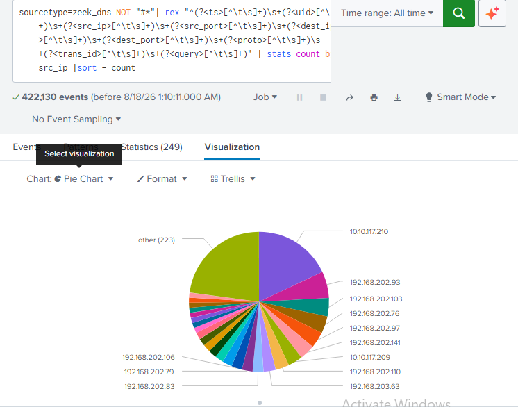
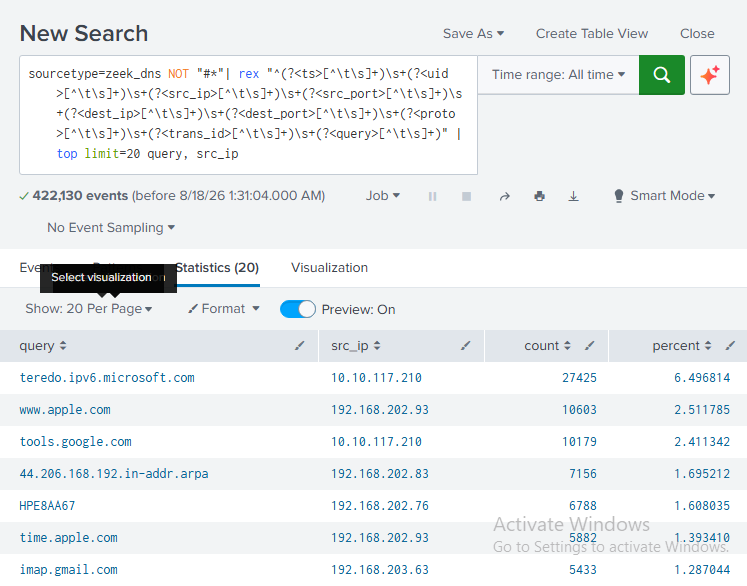
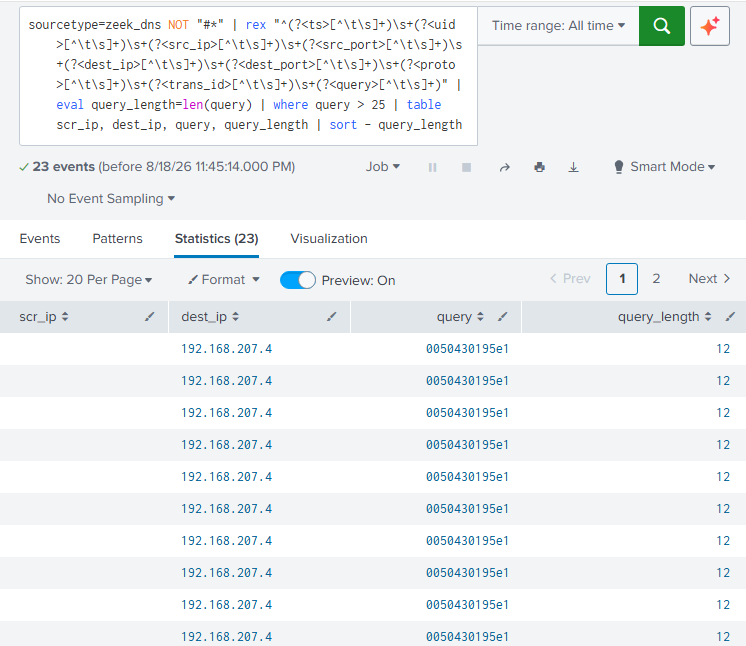
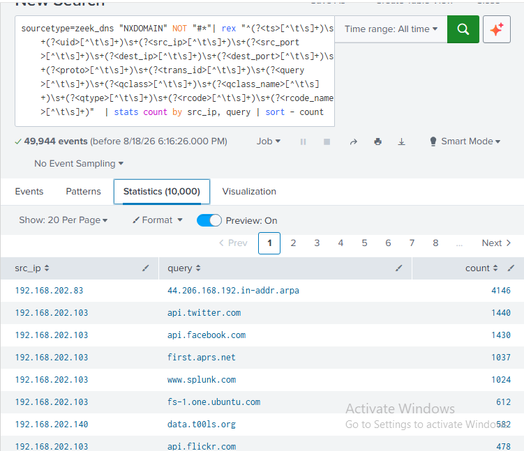
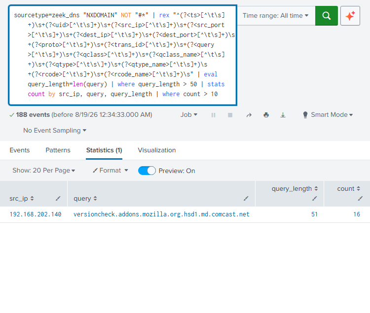

# SOC DNS Threat Hunting & Detection (Splunk + Zeek)

I loaded ~422,000 Zeek DNS log entries into Splunk and hunted for signs of C2 beaconing, DNS tunneling and internal reconnaissance. Then I turned the useful searches into scheduled alerts (`detections/savedsearches.conf`).

**Data:** public Zeek `dns.log` dataset (lab data, not a production network).
**Tools:** Splunk Enterprise, SPL, Zeek logs.

The raw log lines are tab-separated, so every search starts with the same `rex` to pull out `src_ip`, `dest_ip` and `query`. I left it out below to keep the queries readable (it's in `savedsearches.conf`).

---

## MITRE ATT&CK

| Technique | ID | What I looked for |
| :--- | :--- | :--- |
| Application Layer Protocol: DNS | `T1071.004` | Hosts or domains with unusually high query volume (beaconing) |
| Exfiltration Over Alternative Protocol | `T1048.003` | Very long DNS queries (data hidden in subdomains) |
| Gather Victim Network Information: DNS | `T1590.002` | Large numbers of failed (NXDOMAIN) lookups |

---

## 1. Which hosts make the most DNS queries?

```spl
sourcetype="zeek_dns" NOT "#*"
| stats count by src_ip
| sort - count
```

**10.10.117.210** made **75,943** queries, far more than any other host. High volume alone doesn't prove C2, but it's the first host I'd look at.



---

## 2. Which host + domain pairs repeat the most?

```spl
sourcetype="zeek_dns" NOT "#*"
| top limit=20 query, src_ip
```

Most of that volume from **10.10.117.210** was one domain: **teredo.ipv6.microsoft.com** (**27,425** requests). Teredo is a Microsoft IPv6 transition service and is known to be noisy, so this is most likely benign. Before closing it, I would still check whether the host really needs Teredo, because tunneling protocols can be abused.



---

## 3. Long DNS queries (tunneling check)

```spl
sourcetype="zeek_dns" NOT "#*"
| eval query_length=len(query)
| where query_length > 25
| table src_ip, dest_ip, query, query_length
| sort - query_length
```

**Note on the screenshot:** it shows my first run of this search, which had two bugs: I wrote `where query > 25` (that compares text, not length) and misspelled `src_ip` as `scr_ip` (so that column came out empty). Because of that it returned short 12-character names like `0050430195e1`, which look like device hostnames and are not tunneling. The query above is the corrected version. The real long-query analysis is in section 5.



---

## 4. Failed lookups (NXDOMAIN)

```spl
sourcetype="zeek_dns" "NXDOMAIN" NOT "#*"
| stats count by src_ip, query
| sort - count
```

**192.168.202.83** failed the same reverse lookup **4,146** times: `44.206.168.192.in-addr.arpa` (the PTR record for 192.168.206.44). Repeating one lookup thousands of times is abnormal. It could be a scanning tool resolving a target over and over, or just a misconfigured service. Next step would be checking what process on that host is making the requests.



---

## 5. Long queries that fail (possible exfiltration) → false positive

```spl
sourcetype="zeek_dns" "NXDOMAIN" NOT "#*"
| eval query_length=len(query)
| where query_length > 50
| stats count by src_ip, query, query_length
| where count > 10
```

**192.168.202.140** sent a 51-character query 16 times:
`versioncheck.addons.mozilla.org.hsd1.md.comcast.net`

It matches the "long query" rule, but it's a **false positive**: a Firefox update check that failed, and then the ISP's search domain (`hsd1.md.comcast.net`) was appended to it. That's why the tuned alert below excludes `*.comcast.net` and `*.local`.



---

## Alerts (`detections/savedsearches.conf`)

| Alert | Logic | Runs every |
| :--- | :--- | :--- |
| `SOC_ALERT_01_High_Frequency_DNS_Beaconing` | > 50,000 queries from one source | 10 min |
| `SOC_ALERT_02_Reverse_DNS_Reconnaissance_Scan` | > 1,000 failed reverse lookups from one source | 15 min |
| `SOC_ALERT_03_DNS_Tunneling_Exfiltration_Tuned` | Queries > 50 chars, seen > 10 times, excluding `*.comcast.net` and `*.local` | 5 min |

The thresholds are based on this dataset. In a real network they would need a baseline first.

---

## Report

`docs/Incident_Report.pdf` and `docs/Incident_Response.pdf` contain the written summary and response steps.

**Author:** Alejandro José Vargas
